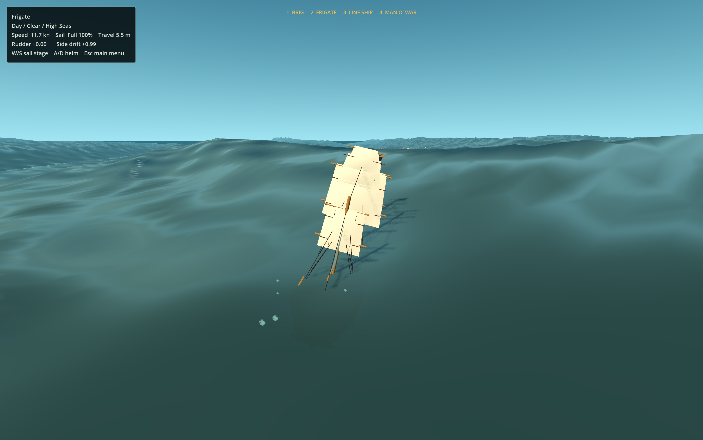

# Sable Wake

An age-of-sail game prototype built with **Godot 4 and GDScript**. It combines ship handling, broadside combat, an ocean environment and a campaign map with ports and fleets.

## Features

- Sail and rudder controls, multiple ship classes and wave-responsive movement.
- Broadside cannons, ammunition choices, ship damage and boarding systems.
- Enemy fleet behaviour and naval battle scenarios.
- Campaign navigation with settlements, trade, contracts and faction relations.
- Ocean rendering using the bundled OceanFFT and Floatable Body add-ons.

[View an existing storm capture](media/combat_storm.png). Screenshots come from the original project's runtime captures.

## Run

1. Open **Godot 4.6.2**.
2. Import this folder's `project.godot` and wait for asset imports.
3. Press **F5** and choose a mode from the main menu.

The project uses **Forward+** and an FFT ocean, so it needs a compatible graphics device. The add-ons are included; no separate download is required.

## Code

- `scripts/game.gd`: game flow and battle/campaign transitions.
- `scripts/player_ship.gd`: ship movement, weapons and damage.
- `scripts/enemy_ship.gd`: opponent behaviour and fleet coordination.
- `scripts/campaign_map_ui.gd`: campaign state and interface.
- `scripts/fft_wave_fluid_area_3d.gd`: integration with the ocean add-on.
- `tools/`: existing scenario, movement and combat checks.

This is a work-in-progress prototype. See `CREDITS.txt` for included third-party resources.

Headless naval movement and floatable-handling checks passed during preparation. Full graphical ocean rendering was not verified in that environment.
